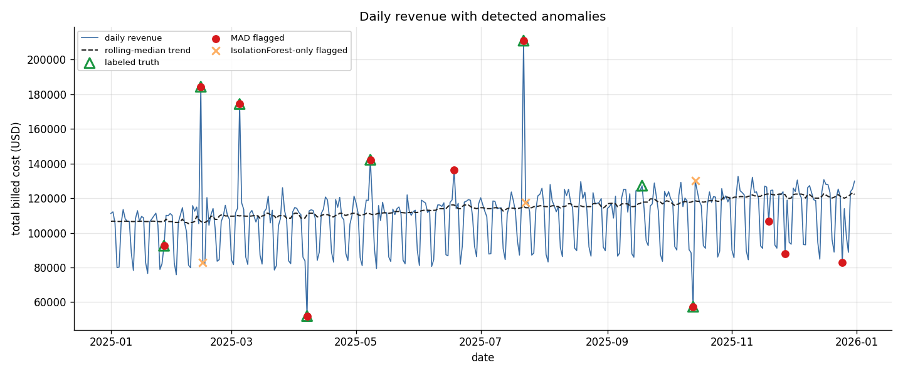
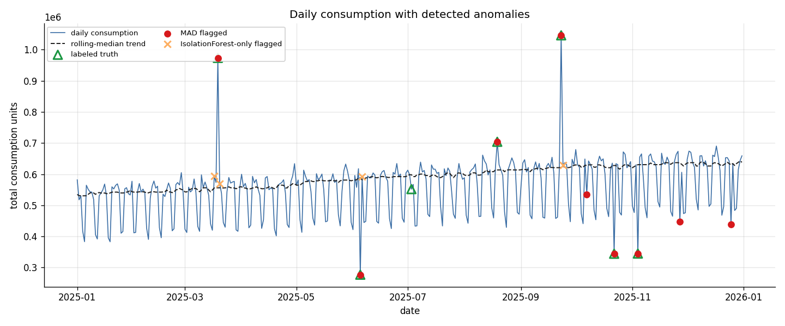
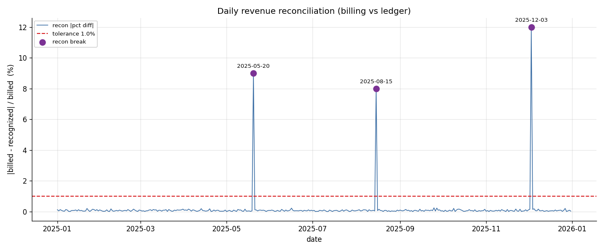

# FinSentry — Finance Data-Quality Monitoring & AI Analyst

**A finance data-quality warehouse that catches revenue anomalies, reconciles two
source systems, and writes a number-verified weekly business review — with an AI
analyst that answers questions or declines rather than guess.**

Runs locally on **DuckDB** with one command; **Snowflake-ready** (DDL + deploy
guide + Streamlit-in-Snowflake port). Author: **Sneha Mishra**
([@Sneha0504](https://github.com/Sneha0504)).

---

> ## ⚠️ Synthetic data
>
> **All data in this project is SYNTHETIC**, generated from a fixed seed (`42`) with
> documented assumptions (see [`config.yaml`](config.yaml)). It contains **planted,
> labeled anomalies** that serve as ground truth for the detector's precision/recall,
> plus **unlabeled confounders** (holiday dips, month-end bumps, two one-off shock
> days) that keep the problem honest. No real customer, billing, or revenue data is
> used anywhere. Numbers below come from a **real run** of the pipeline, not from
> memory — reproduce them with `make reproduce`.

> **Airflow is optional / deploy-only.** The reproduce path is the plain Python
> runner (`finsentry.pipeline_runner`); the Airflow DAG in [`airflow/`](airflow/)
> is the orchestration *deploy target* and is not needed to reproduce any figure.

---

## Architecture

```
            data/raw/*.csv  (SYNTHETIC, fixed seed 42)
                   │   billing_line_items · revenue_ledger · consumption · anomaly_labels
                   ▼
            DuckDB  raw schema            (finsentry.load_raw)
                   │
                   ▼
            dbt staging + marts   ──►  65 dbt data tests
            (9 models, analytics schema)   uniqueness · not_null · relationships/FK
                   │                        cross-source reconciliation (singular)
                   │                        missing-source-day (singular)
                   ▼
            Anomaly detection / DQ monitoring
            robust seasonal median/MAD + Isolation Forest
                   │
                   ├─►  analytics.dq_failure_log  (+ reports/dq_failure_log.csv)  ──►  runbook.md
                   │
                   ▼
            AI analyst  (LLM tool-calling loop: read-only SQL · anomaly check · chart)
            ├─ weekly business review        (reports/weekly_review.md)
            ├─ number verification           (every number re-queried, marker-bound)
            └─ 15-question eval + 43 probes   (every tool call logged)
                   │
                   ▼
            Streamlit app  (Data health · Anomalies · Weekly review)
```

- **Reproduce path (this repo):** `finsentry.pipeline_runner` — 8 stages, no Docker,
  no credentials, one command.
- **Deploy path:** Airflow DAG (`airflow/`) orchestrates the identical stages;
 

---

## Results (from a real run)

All figures below are read from the `reports/*` outputs and `config.yaml` after
`make reproduce`. The `reports/*` files are **generated at runtime and gitignored**
(not committed, so the paths below are references, not links) — run the pipeline to
produce them. Only the headline figures are committed, under
[`assets/`](assets/) (regenerable with `make figures`).

### dbt models & tests
- **9 dbt models** (4 staging + 5 marts: `dim_date`, `fct_daily_revenue`,
  `fct_daily_consumption`, `fct_service_daily`, `mart_daily_health`).
- **65 data tests — all green**: uniqueness, not-null, referential integrity
  (relationships/FK), a **data-driven cross-source reconciliation** singular test
  (allowlist from the labels — it fails on any *new* unexplained break), and a
  **missing-source-day** singular test.

### Full-year KPIs (`analytics.mart_daily_health`, 365 days)
| Metric | Value |
|---|---|
| Total billed cost | **$39,498,830.31** |
| Total recognized revenue | **$39,515,762.57** |
| Total consumption units | **202,791,936.82** |
| Avg active accounts / day | **3,314.48** |
| Calendar days covered | **365** (0 missing) |
| Reconciliation breaks | **3** |

### Anomaly detection — precision / recall / F1 vs labeled anomalies
Source (generated at runtime): `reports/anomaly_eval.json` · committed figure:
[`assets/precision_recall.png`](assets/precision_recall.png)

| Detector | TP | FP | FN | Precision | Recall | F1 |
|---|---:|---:|---:|---:|---:|---:|
| **Robust median/MAD** (|z| > 3.5) | 13 | 7 | 2 | **0.650** | **0.867** | **0.743** |
| **Isolation Forest** (contamination 0.03) | 11 | 11 | 4 | 0.500 | 0.733 | 0.595 |
| **Union** (either detector) | 13 | 14 | 2 | 0.481 | 0.867 | 0.619 |

- Measured against **15 labeled metric anomalies** (10 large + 5 subtle) over
  **365 scored days**.
- **Reconciliation breaks: 3/3 detected (recall 1.00)** — these are caught by the
  dbt reconciliation rule / `mart_daily_health.recon_breach`, not the series
  detectors (planted breaks: 2025-05-20, 2025-08-15, 2025-12-03).
- **MAD leads on F1 (0.743).** Isolation Forest underperforms here — see
  *Limitations*.





### DQ failure log
Source (generated at runtime): `reports/dq_failure_log.csv` — **30 rows**,
each with a cause and a `is_known_label` flag:
- 14 revenue anomalies, 13 consumption anomalies, 3 reconciliation breaks.
- 16 match a planted ground-truth label; 14 are suspected false positives
  (attributed to a known confounder, neighbor-day spillover, or near-threshold
  noise). Precision < 1 is **by design** — the cost of keeping recall high.

### Weekly business review (week 2025-12-01 … 12-07, ISO week 49)
Source (generated at runtime): `reports/weekly_review.md` +
`reports/weekly_review_verification.json`
- Billed cost **$809,222.86**, **+6.08%** WoW (prior week $762,874.34).
- Recognized revenue **$825,156.40**; consumption **4,254,385.67** units (**+6.92%** WoW).
- Avg **3,445.29** active accounts/day; **1** reconciliation break (2025-12-03,
  $15,658.66, 12.00%); **0** detector-flagged anomaly-days.
- **Number verification: 19/19 numbers matched, 0 mismatched — ALL-PASS**, mode
  `marker-bound` (each number is bound to a specific claim via a hidden marker,
  re-queried from the warehouse, and checked for order + coverage, fail-closed).

### Analyst evaluation
Source (generated at runtime): `reports/eval_results.json` / `reports/eval_results.md`
- **15 / 15 questions correct (100%)**, each expected value independently
  ground-truth-checked.
- **43 / 43 held-out adversarial probes behaved correctly** (correct-or-declined):
  supported reword/filter shapes answered, out-of-scope shapes declined.
- **28 tool calls logged** to `reports/eval_tool_calls.jsonl` (every call recorded).

---

## Design decisions (and why)

- **DuckDB as a Snowflake stand-in** — so every figure comes from a real, one-command
  run with no external account or credentials, while the Snowflake DDL + deploy guide
  ship alongside for the real-warehouse path. Same dbt project, same `analytics`
  schema, same SQL.
- **Robust seasonal median/MAD + Isolation Forest** — a transparent statistical
  detector (deseasonalize by weekday, robust z-score via median/MAD) paired with a
  model-based one. The MAD detector is interpretable and leads on F1; the pairing
  documents a real trade-off rather than cherry-picking one method.
- **Data-driven reconciliation test** — the dbt reconciliation test reads its
  allowlist from the planted labels, so the three known breaks pass but **any new,
  unexplained break fails the build**. That is the behavior you want in production.
- **Groq (live) + deterministic offline analyst** — the live free-text path uses
  **Groq** (free tier, `GROQ_API_KEY`); a deterministic **offline planner** (no key)
  produces the **committed, reproducible** weekly review and eval numbers.
- **Positive, fail-closed planner gate** — the offline planner answers only when the
  *entire* question is explained by recognized structure; any unexplained token makes
  it **decline** (`UNSUPPORTED: …`) rather than return a misleading answer.
- **Marker-bound number verification** — every number in the weekly review is bound
  to a specific claim via a hidden `<!--c:ID-->` marker, re-queried from the
  warehouse, and checked for value, marker order, and full coverage (fail-closed).

---

## Limitations & failure cases found

Honest list of real limits surfaced during development and review:

- **The offline analyst is a narrow, positive-gate planner.** It answers a fixed set
  of question shapes (revenue/consumption/reconciliation/anomaly/service/chart with
  parseable periods and thresholds) and **declines everything else** — region
  breakdowns, medians/percentiles, per-X ratios, weekday/quarter grouping, Nth-highest,
  growth deltas, yes/no, cross-subject conditions. This trades coverage for
  never-answering-wrong. Real natural-language breadth is the **Groq** path.
- **Number-verification guarantees differ by path.** The offline template review is
  fully guarded (per-claim recompute + marker binding + marker-order + coverage,
  fail-closed → the committed `19/19 ALL-PASS`). The **Groq** free-text path binds
  each number to its claim's value but does **not** verify semantic prose placement
  (a pair-swap with correct markers can pass) and does **not** scan spelled-out
  numbers — so the **offline** path is what produces committed/reproducible results.
- **Isolation Forest underperforms the statistical detector here** (F1 **0.595** vs
  MAD **0.743**; precision 0.500 vs 0.650). The signal is a single, deseasonalized,
  univariate series, which favors a robust z-score; Isolation Forest has no extra
  dimensions to exploit and flags more false positives (11 vs 7). It is kept to
  document the comparison, not because it wins.
- **Float-boundary thresholds follow the raw data.** The planted "8%" reconciliation
  break is stored as `0.08000003…`, so a query for breaks *exceeding 8%* counts it.
  This is the real data, reported faithfully (e.g. "breaks ≥ 9%" returns 2; "> 10%"
  returns 1).
- **Reconciliation / missing-day handling is asymmetric.** A day missing from the
  **ledger** shows recognized=0 → 100% recon break; a day missing from **billing**
  gives a NULL pct-diff (no breach) and is caught by the `assert_no_missing_source_day`
  test instead; a day missing from **both** has no revenue row and is caught by the
  `not_null` tests on the mart. See [`runbook.md`](runbook.md) §5.
- **Read-only SQL is enforced in depth.** The analyst's SQL tool uses a validator
  (single `SELECT`/`WITH`, no DDL/DML, no file/URL functions), a `read_only=True`
  connection, and session-level `enable_external_access=false` — and **fails closed**
  if it cannot guarantee external access is off.
- **Groq requires `httpx==0.27.2`.** `groq==0.11.0` passes `proxies=` to httpx, which
  `httpx 0.28` removed; without the pin the live client fails to construct (the
  offline analyst still works). Likewise `pyarrow` is pinned to **17.0.0** because
  newer pyarrow requires numpy ≥ 2.0, conflicting with the pinned `numpy==1.26.4`
  and breaking Streamlit's `st.dataframe`.

---

## Reproduce

**Prerequisites:** Python **3.11 or 3.12** (numpy 1.26.4 ships no cp313 wheels),
`make`, and a POSIX shell. No Docker, no cloud account, no API key.

```bash
# 1. one-time: create .venv and install pinned deps + the package (editable)
make setup

# 2. THE one command: clean -> full 8-stage pipeline -> committed figures
make reproduce
```

`make reproduce` runs **generate → load → dbt run → dbt test → dq_monitoring →
weekly_review → verify_numbers → eval**, then promotes the four headline figures
into `assets/`. It exits non-zero if any required stage fails (number verification
failing fails the build). Everything is deterministic: **fixed seed 42**, pinned
dependencies ([`requirements.txt`](requirements.txt)), no wall-clock in any output.
Every figure in this README comes from that real run.

```bash
make figures     # regenerate the committed figures into assets/
make test        # dbt data tests only
make streamlit   # launch the Streamlit app  (http://localhost:8501)
make clean       # remove generated data/reports/dbt artifacts (keeps .venv)
```

**Streamlit app** — three views (Data health, Anomalies, Weekly revenue review),
read-only over `data/warehouse.duckdb`:

```bash
make streamlit
# or:  .venv/bin/streamlit run streamlit/app.py
```

The app is **Snowflake-portable**: the same code deploys as Streamlit-in-Snowflake
by swapping only the connection in `_get_connection()` — see `snowflake/DEPLOY.md`.

**Live Groq analyst (optional)** — the committed numbers use the deterministic
offline analyst; to run the live free-text loop:

```bash
export GROQ_API_KEY=...      # free tier at https://console.groq.com
.venv/bin/python -m finsentry.pipeline_runner --provider groq
```

> **Note on the path containing a space.** This project lives under a directory with
> a space (`Coding Projects`). The `Makefile` and scripts quote every path so the
> targets work regardless; the one-command reproduce runs green as-is.

---

## Repository layout

```
finsentry/
├── README.md                  # this file
├── PROJECT.md                 # original spec + build decisions
├── runbook.md                 # triage guide for every DQ failure type
├── Makefile                   # setup · reproduce · figures · streamlit · test · clean
├── config.yaml                # single source of truth (seed, anomalies, detector params)
├── requirements.txt           # pinned core deps (DuckDB; no Airflow)
├── requirements-airflow.txt   # Airflow deps (deploy only; separate venv)
├── pyproject.toml             # editable install of the finsentry package
├── assets/                    # COMMITTED figures from the real run (README images)
├── scripts/
│   └── copy_figures.py        # promote reports/*.png -> assets/ (make figures)
├── src/finsentry/
│   ├── config.py              # typed config loader
│   ├── generate_data.py       # synthetic data (fixed seed, planted labels, confounders)
│   ├── load_raw.py            # CSVs -> DuckDB raw schema
│   ├── anomaly.py             # median/MAD + Isolation Forest detection
│   ├── anomaly_eval.py        # precision/recall/F1 vs labels
│   ├── failure_log.py         # unified DQ failure log + causes
│   ├── figures.py             # deterministic matplotlib figures
│   ├── pipeline_runner.py     # the 8-stage local runner (reproduce path)
│   ├── analyst/               # LLM tool-calling loop
│   │   ├── tools.py           #   3 tools: read-only SQL · anomaly check · chart
│   │   ├── planner.py         #   deterministic offline planner (fail-closed gate)
│   │   ├── llm.py             #   Groq provider (live) / offline selection
│   │   ├── agent.py           #   the loop
│   │   ├── weekly_review.py   #   weekly business review generator
│   │   └── verify_numbers.py  #   marker-bound number verification
│   └── eval/                  # 15 questions + 43 probes + runner
├── dbt/finsentry/             # dbt project (9 models, 65 tests, 3 singular tests)
├── streamlit/app.py           # 3-view app (Snowflake-portable)
├── snowflake/                 # ddl.sql + DEPLOY.md (Snowflake-equivalent path)
├── airflow/                   # DAG + docker-compose (deploy-only orchestration)
├── data/                      # raw CSVs + warehouse.duckdb (gitignored; regenerated)
└── reports/                   # metrics, figures, logs (gitignored; regenerated)
```

---

## Author

**Sneha Mishra** — GitHub [@Sneha0504](https://github.com/Sneha0504).
See [`CONTRIBUTORS.md`](CONTRIBUTORS.md).
